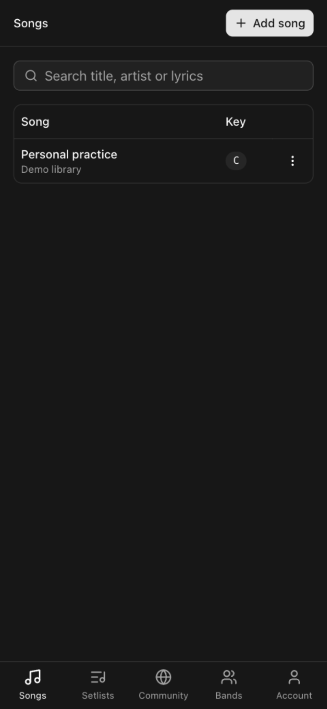
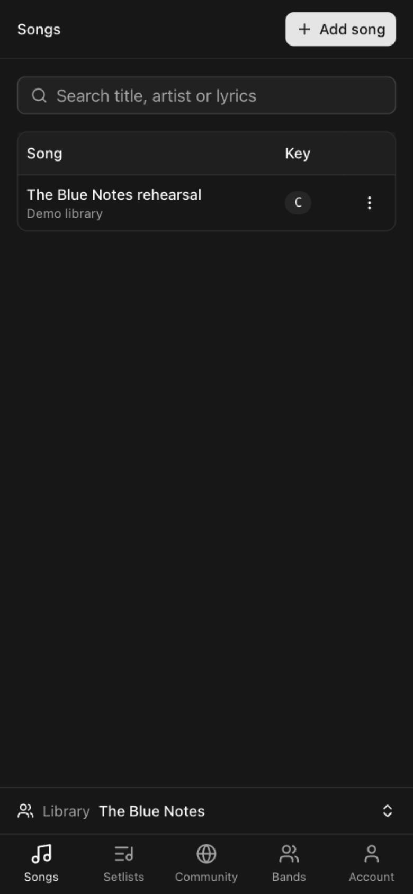
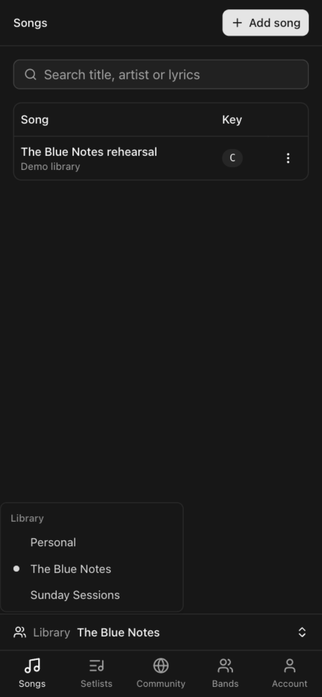

# Mobile band switching (issue #1)

The desktop sidebar contained the only library selector. Mobile bottom navigation
now includes the same menu in a 44px row above its five tabs when bands exist.
The active library remains visible; selecting Personal or a band opens Songs.
The shell reserves space for the extra row and the device safe area.

## Browser regression checklist

Use a local account with two bands and distinct songs/setlists in each library.

- At 390 × 844, switch Personal → first band → second band → Personal.
  Confirm each library shows only its songs, then check its Setlists tab.
- Switch from Setlists and confirm navigation returns to Songs.
- Reopen the menu and confirm the active library has the checked radio item.
- Open the menu and use Home, then Enter to select Personal; Escape dismisses it.
- At 320 × 568, confirm all five tabs fit without horizontal page overflow.
- Open a song: bottom navigation and its reserved space should disappear.
- At 1280 × 800, confirm the desktop selector still changes libraries.
- Sign out: the extra row disappears and the original five-tab navigation remains.

All checks above passed locally. Screenshots use synthetic local data, captured
at 390 × 844 CSS pixels (2× image scale).

| Before: no selector | After: band selected | Menu: checked library |
| --- | --- | --- |
|  |  |  |
