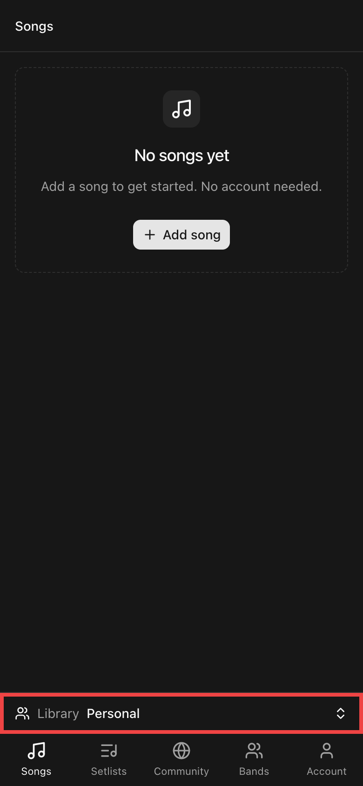
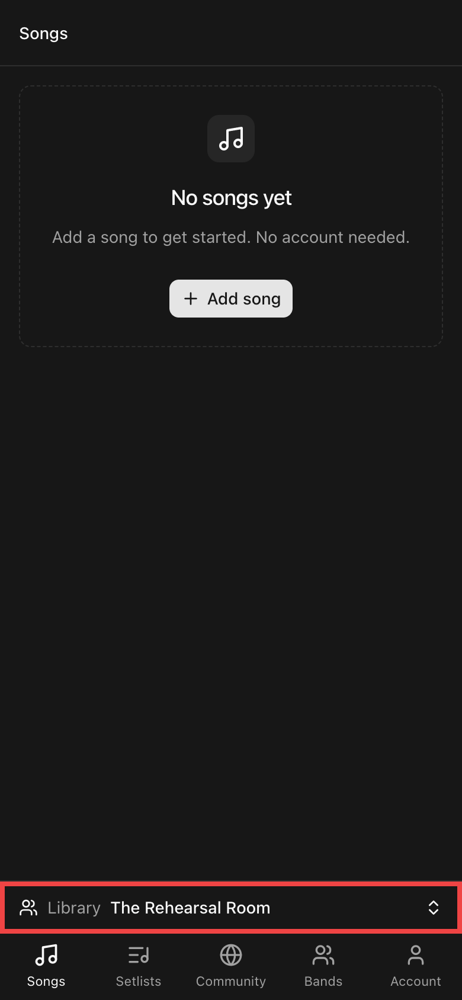

# Remember the selected library

The active library (Personal or a band) lived in React state only, so every
reload or new visit reset it to Personal. It is now stored in localStorage per
account (`chords:owner:<account>`) and only changes when the user picks another
library. If the remembered band no longer appears in the user's band list (left
or deleted), the app falls back to Personal and clears the key.

## Checks

- Select a band, reload: the band stays selected (old code: back to Personal).
- Store an unknown band id, reload: Personal is selected and the key is removed.

Screenshots use synthetic local data at 390 × 844 CSS pixels (2× image scale).

| Before: reload resets to Personal | After: band kept after reload |
| --- | --- |
|  |  |
